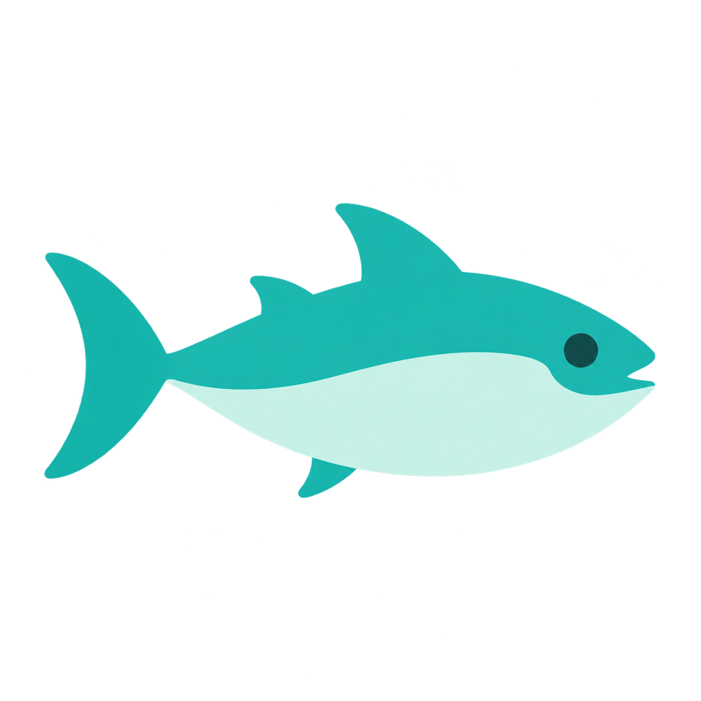

<div align="center">
  
  <h1>Tuna Studio</h1>
  <p><strong>Your GPU. Your data. Your model.</strong></p>
  <p>Fine-tune, chat, and export from one local workspace.</p>
  <p>
    <a href="https://github.com/ahpah-dev/tuna-studio/archive/refs/heads/main.zip"><strong>Download source ZIP</strong></a>
    &nbsp; · &nbsp;
    <a href="#get-started">Get started</a>
    &nbsp; · &nbsp;
    <a href="docs/TRAINING.md">Training guide</a>
    &nbsp; · &nbsp;
    <a href="docs/CHAT-PERFORMANCE.md">Performance results</a>
  </p>
</div>

---

**Turn your examples into a model you can actually use.** Tuna Studio brings
LoRA, QLoRA, and **Tuna — policy-conditioned QLoRA** into a clean visual app.
Import your JSONL, train on your own machine, talk to the result, and save a
standalone GGUF for your favorite local runtime.

Your datasets, system policies, and training stay on your computer. No cloud
account is required to use the app.

## One workspace, from dataset to conversation

| What you want to do | What Tuna Studio gives you |
| --- | --- |
| **Make a model your own** | LoRA, 4-bit QLoRA, and Tuna with your saved system policy |
| **Train with less memory** | NF4 double quantization, paged AdamW8bit, gradient checkpointing, and gradient accumulation |
| **See what is happening** | Live loss, throughput, elapsed time, CUDA memory, logs, and persistent run history |
| **Start with a GGUF** | Import a supported local Llama-family GGUF, fine-tune it, and export a new tuned GGUF |
| **Use the result immediately** | Built-in streaming chat with saved conversations and measured tokens/s |
| **Give your model room to think** | Native reasoning on supported models, a collapsible thinking panel, and an Unlimited reply option |
| **Take your model with you** | Adapter ZIPs, standalone Q8_0 or F16 GGUF exports, and Ollama companion files |
| **Keep control** | Local files, offline model loading, stop/cancel controls, and automatic idle model unloading |

**Unlimited** removes the fixed reply cap and uses the remaining loaded context
— currently up to 8,192 tokens, shared by conversation, reasoning, and answer.
You can stop a reply at any time.

## Faster local chat, measured

**6.6× higher median generation throughput** on the measured
**RTX 5070 / Qwen3.5-2B** workload.

| Chat inference path | Median tokens/s | Time to generate 128 tokens |
| --- | ---: | ---: |
| Previous NF4 base + separate adapter | 8.56 | 14.95 s |
| Optimized BF16 + merged adapter + fast kernels + compiled decode | **56.49** | **2.27 s** |

Tuna Studio selects BF16/FP16 when the model fits in GPU memory, merges dense
adapters in memory, and retains NF4 for larger models. Supported Qwen3.5 models
can use optional fused linear-attention kernels and compiled static-cache decoding.

These are before/after **chat inference** measurements with the same saved
adapter, prompt, and 128-token output length; model loading and initial
compilation are excluded. See the [full benchmark and verification](docs/CHAT-PERFORMANCE.md)
for the setup, memory measurements, and tradeoffs.

## Get started

### Download and launch

[**Download Tuna Studio as a ZIP**](https://github.com/ahpah-dev/tuna-studio/archive/refs/heads/main.zip)
and extract it, or clone the repository:

```powershell
git clone https://github.com/ahpah-dev/tuna-studio.git
cd tuna-studio
```

You need Python installed. Python **3.11 or 3.12** is a practical starting point
for the GPU runtime.

**Windows with an NVIDIA GPU:**

```powershell
.\setup-cuda.ps1
.\start-tuna.ps1 -OpenBrowser
```

The setup script creates an app-local `.venv`, installs the CUDA-enabled
training runtime, and verifies a real GPU operation. It uses official CUDA 13.0
PyTorch wheels and requires a compatible NVIDIA driver. A separate CUDA Toolkit
installation is not required.

**Want to explore the dashboard first?**

```powershell
python server.py
```

Open [**127.0.0.1:8765**](http://127.0.0.1:8765). The dashboard runs on Python's
standard library, with no npm build or ML package installation needed to explore
it. Training, model chat, and conversion use the additional ML runtime.
Direct launches automatically use the app's `.venv` when present.
Press **Ctrl+C** to stop a foreground server.

For manual environment setup and CPU LoRA, follow the [training guide](docs/TRAINING.md).

### Optional: enable faster Qwen3.5 chat

After CUDA setup, install the optional fast chat runtime:

```powershell
.\setup-fast-chat.ps1
```

Load or reload your model afterward. First-time kernel preparation and
compilation can take several minutes; subsequent replies reuse the prepared
runtime. See [chat setup and memory controls](docs/CHAT.md).

## Train your first model

1. **Bring your examples.** Import a UTF-8 `.jsonl` file in **Datasets**.
   Validation and previews help you check it before training.
2. **Choose your base.** Use a local model directory, a Hugging Face model ID,
   or a supported local Llama-family `.gguf`.
3. **Pick your method.** Choose LoRA, QLoRA, or Tuna. For Tuna, enter the system
   policy you want included throughout training and chat.
4. **Start the run.** Follow real training metrics and logs. Stop when needed;
   saved run history keeps the configuration and results together.
5. **Try it and take it with you.** Open **Chat with model**, download the
   adapter, or choose **Save as GGUF**.

A dataset can be as simple as one conversation per line:

```jsonl
{"messages":[{"role":"user","content":"What is Tuna Studio?"},{"role":"assistant","content":"A local workspace for fine-tuning, chatting with, and exporting your own models."}]}
```

The dashboard also accepts `prompt` / `completion` rows.
[See dataset formats and training options →](docs/TRAINING.md)

## Meet Tuna

**Tuna is policy-conditioned QLoRA.** It combines memory-efficient 4-bit
adapter training with one canonical system policy across your training examples.

During training, Tuna replaces dataset system messages with your saved policy.
Its export includes the policy, a manifest, and a serving wrapper. Built-in
chat applies that policy on every turn and rejects caller system/developer
messages and reserved control tokens.

The wrapper controls how prompts are assembled; learned adherence is
probabilistic. When using a GGUF in another runtime, apply the included policy
there. Ollama companion files make that setup easier.

| Method | Base model | Where it runs |
| --- | --- | --- |
| **LoRA** | Frozen full-precision weights + trainable adapters | CPU or CUDA |
| **QLoRA** | Frozen 4-bit NF4 weights + trainable adapters | CUDA |
| **Tuna** | QLoRA conditioned on your canonical policy | CUDA |

[How Tuna training and policy binding work →](docs/TRAINING.md)

## GGUF in. Tuned GGUF out.

Start from a supported **Llama-family GGUF** without downloading a second base
model. Tuna Studio restores a local training checkpoint, trains your adapter,
merges the learned changes, and exports a **new standalone GGUF**.

Choose **Q8_0** for a smaller file or **F16** for floating-point weights.
Exports include progress, cancellation, checksums, and direct downloads.
Use the result in a compatible runtime such as llama.cpp or LM Studio, or
download the companion files for Ollama.

The complete real-model round trip has been verified on an RTX 5070, including
checks of **all 294 adapted matrices** and native llama.cpp inference.
Import and export need additional disk space; keep the restored base checkpoint
while using its adapters.

[GGUF guide](docs/GGUF.md) · [Real-model verification](docs/GGUF-TRAINING-VERIFICATION.md)

## Local by design

- **Your data stays yours.** Datasets, policies, runs, logs, and exports live in
  local files. Chat history stays in your browser.
- **Offline when you choose.** Use cached/local models and turn off
  **Download missing models**. Enable it to fetch model files from Hugging Face;
  datasets and prompts are never uploaded.
- **A local app, with local assets.** The server binds to loopback
  `127.0.0.1`; the UI uses no remote scripts, fonts, or telemetry.

The source download includes the app, logo, setup scripts, tests, and verification
reports. Bring your own model weights and examples.

## Tested on real hardware

**85 Python tests passed**, alongside Node UI checks and real CPU/CUDA
execution checks. Coverage includes training, GGUF import/export, policy binding,
streaming chat, cancellation, context budgets, and reasoning.

GPU verification used an **RTX 5070**, with actual QLoRA and Tuna optimizer
updates, changed adapter weights, and working exports. The reports distinguish
small execution fixtures from real-model round trips and inference benchmarks.

```powershell
python -m unittest discover -s tests -v
node tests/test_chat_ui.js
```

Some model/tokenizer checks require the optional ML dependencies. Current
training is **single-device and text-only**; resume, distributed training,
sequence packing, and automated evaluation are outside the current feature set.
Adapter-only exports use their original base; merged GGUF exports are standalone.

## Go deeper

| Guide | What you will find |
| --- | --- |
| [Training](docs/TRAINING.md) | Runtime setup, model support, JSONL formats, methods, and worker CLI |
| [Chat](docs/CHAT.md) | Local inference, reasoning, response length, and memory controls |
| [GGUF](docs/GGUF.md) | Import, export, resource requirements, and Ollama usage |
| [Chat performance](docs/CHAT-PERFORMANCE.md) | Measured speed improvements and reproducible workload |
| [GGUF verification](docs/GGUF-TRAINING-VERIFICATION.md) | Real-model training and export checks |
| [Verification notes](docs/VERIFICATION.md) | Implementation checks and environment records |
| [Third-party notices](THIRD_PARTY_NOTICES.md) | Bundled llama.cpp source and upstream license |

---

**Ready to build a model that feels like yours?**
[Download Tuna Studio](https://github.com/ahpah-dev/tuna-studio/archive/refs/heads/main.zip)
and start with your first JSONL.
